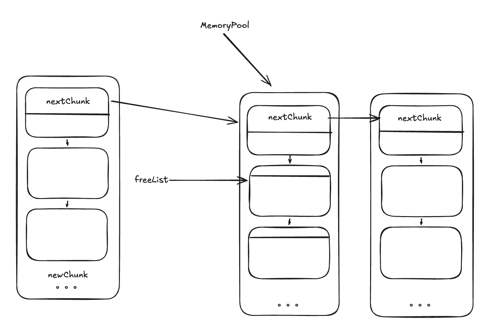
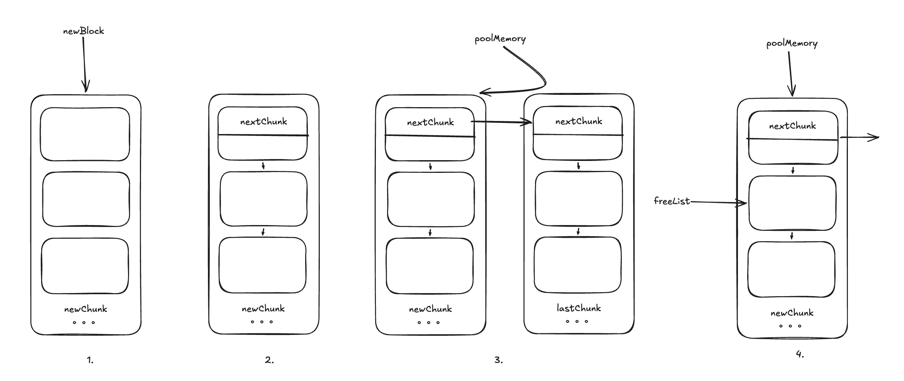

# Simple C++ Memory Pool

> **AI-generated:** This English README was generated by AI.

This repository demonstrates a simple fixed-size memory pool implemented in
C++. It is intended to help readers understand the basic design and trade-offs
of a memory pool; it is not suitable for production use.

## Overview

The pool obtains memory from the system in chunks and divides each chunk into
equal-sized blocks. One block in each chunk stores the link to the next chunk;
the remaining blocks are available for allocation. A free list tracks available
blocks.

- `expandPool()` allocates a new chunk when the pool is initialized or when no
  free blocks remain. It links the chunk into the chunk list and its usable
  blocks into the free list.
- `alloc()` removes a block from the head of the free list and returns it. If
  the list is empty, it first expands the pool.
- `dealloc()` puts a returned block at the head of the free list.

Chunk allocation reduces repeated calls to the general-purpose allocator.
Allocation and release within an existing chunk only update pointers.



## Requirements

The project requires CMake and a C++ compiler. The original development
environment was:

- Ubuntu 24.04.5 LTS, Linux 7.0.0-38-generic, x86_64
- GNU g++ 13.3.0
- CMake 3.28.3
- GNU Make 4.3
- GDB 15.1 and Visual Studio Code (optional)

Basic C++ and data-structure knowledge is helpful. CMake and debugging tools
are useful when building and exploring the example.

## Build and run

From the repository root, configure and build:

```sh
cmake -S . -B build
cmake --build build
```

Run the example executable:

```sh
./build/MemoryPoolTest
```

Or run the registered CTest test:

```sh
ctest --test-dir build --output-on-failure
```

The test creates a pool with 128-byte blocks and 20 initial blocks, allocates
1,000 blocks, releases the first 500, allocates 500 blocks again, and then
releases all 1,000 blocks.

## Implementation details

### Data structures

Each block uses `next` to link free blocks. The first block in a chunk also
uses `nextChunk` to link chunks for cleanup. The pool stores the block size,
the number of usable blocks per chunk, the free-list head, and the chunk-list
head:

```cpp
struct Block {
    Block* next;
    Block* nextChunk;
};

std::size_t blockSize;
std::size_t totalBlocks;
Block* freeList;
void* poolMemory;
```

The constructor ensures the block is large enough for the bookkeeping links
and rounds its size up to an 8-byte boundary. It rejects an initial block count
of zero, initializes the list heads, and allocates the first chunk.

### Expanding the pool

For a block size `blockSize` and `totalBlocks` usable blocks, `expandPool()`
requests `blockSize * (totalBlocks + 1)` bytes. The extra block at the start is
reserved for chunk-list metadata. The remaining blocks are linked into the
free list, and the new chunk is inserted at the head of the chunk list:

```cpp
void* newMemory = operator new(blockSize * (totalBlocks + 1));
Block* newBlock = static_cast<Block*>(newMemory);
newBlock->next = reinterpret_cast<Block*>(
    static_cast<char*>(newMemory) + blockSize);
newBlock->nextChunk = static_cast<Block*>(poolMemory);
poolMemory = newBlock;
freeList = newBlock->next;
```

In the complete implementation, the remaining usable blocks are also linked
together and the final free-list link is set to `nullptr`. Keeping the chunk
links in the reserved block lets the destructor release all chunks without
allocating a separate list.



### Allocation, release, and destruction

`alloc()` expands the pool if the free list is empty, then removes and returns
its first block. `dealloc()` ignores a null pointer; otherwise, it inserts the
returned block at the free-list head. When the pool is destroyed, it follows
the chunk links and releases every allocated chunk.

The block-size alignment is intended to provide 8-byte boundaries, which can
be useful for common data types. Whether this improves performance depends on
the platform and workload; modern processors often handle unaligned accesses
efficiently.

Copy and move operations are disabled because the pool owns raw memory and
manually releases it. Implicitly copying its pointers could result in multiple
objects attempting to manage or release the same chunks.

### C++ casts

The implementation uses casts for low-level memory handling. In general:

- `static_cast` performs compile-time checked conversions between related
  types, including many numeric conversions.
- `dynamic_cast` performs runtime-checked casts in polymorphic class
  hierarchies. An invalid pointer cast returns `nullptr`; an invalid reference
  cast throws `std::bad_cast`.
- `const_cast` changes `const` or `volatile` qualifiers. Modifying an object
  that was originally declared `const` is undefined behavior.
- `reinterpret_cast` reinterprets a value at a low level, such as converting
  between unrelated pointer types. It does not make an otherwise invalid
  access safe.

Use these casts only when the intended conversion and its safety requirements
are understood.

## Limitations

- The pool is not thread-safe. Synchronize calls before using one pool from
  multiple threads.
- The pool does not detect double frees or pointers that do not belong to it.
  Either can corrupt the free list.
- Each pool serves blocks of one size. For a standard-library alternative
  intended for pooled allocations, see
  [`std::pmr::unsynchronized_pool_resource`](https://en.cppreference.com/w/cpp/memory/unsynchronized_pool_resource).
- This educational implementation should not replace a production allocator.

## Development history

The implementation evolved through several iterations:

1. **v1.0:** Added basic allocation and release, but did not preserve the
   previous chunk when expanding the pool, which could leak memory.
2. **v2.0:** Considered ways to track chunks. A separate global list would
   require additional bookkeeping; storing a link at the end of each chunk
   complicates block management; reserving the first block for the next-chunk
   link keeps cleanup simple at the cost of one block per chunk. The third
   approach was selected.
3. **v3.0:** Changed chunk insertion from tail insertion to head insertion.
   This avoids traversing the chunk list during expansion.
4. **v3.1:** Added validation that `initialBlocks` is greater than zero and
   adjusted the block size so it can hold the bookkeeping pointers.
5. **v3.2:** Disabled copy construction and copy assignment to prevent
   accidental ownership duplication and the resulting leaks or dangling
   pointers.

The example can serve as a starting point for studying memory-pool concepts;
real applications should select an allocator appropriate to their needs.
